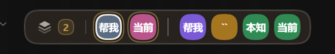
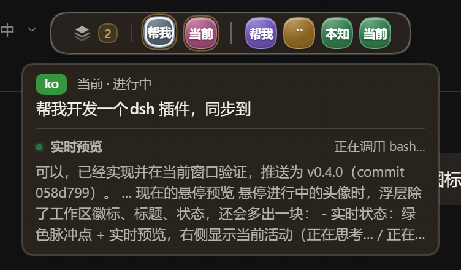
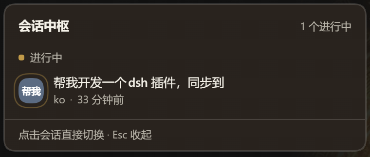
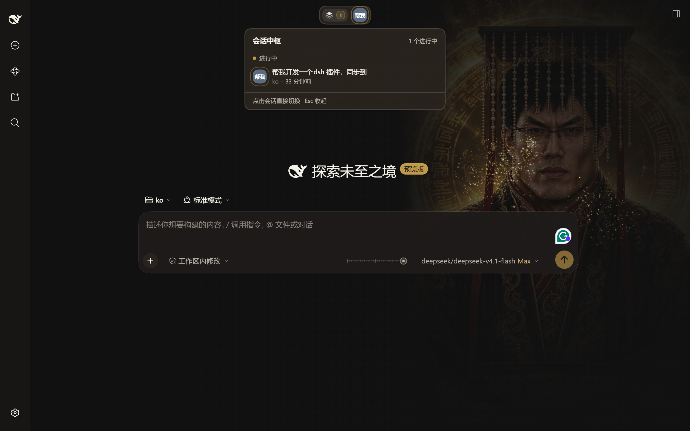

# Session Hub · dsh-session-hub

English | [简体中文](README.zh-CN.md)

> A small session island floating at the top center of the DSH Web UI: sessions that are running, or that finished while you were elsewhere, are visible at a glance, with your recently opened sessions beside them. Hover a running session to preview its live output; click to switch without opening the sidebar.



*Running / finished-unread sessions on the left, recently opened sessions on the right, separated by a vertical divider.*

## Why it exists

DSH makes it easy to have many sessions open across different workspaces. Switching between them usually means expanding the left sidebar, finding the workspace, then finding the title. Session Hub puts the sessions that need your attention at the top center of the window:

- **Running** — any session currently running in any workspace, marked with a pulsing ring.
- **Just finished** — a session that stopped while you were elsewhere and that you have not opened yet, marked with a green check. It disappears once you open it.
- **Recently opened** — up to four recently opened sessions, separated from the active group by a vertical divider. Before you have any history, the most recently active sessions fill the gap.
- The session you are currently viewing is tagged **Current**, so you cannot switch to it by accident.
- Session avatars use a fixed-hue gradient glass: a soft top-left highlight, a translucent color band, a 1px light rim, a frosted backdrop, inner shadows, a tiny specular glint and a same-hue halo. Hovering widens an icon from 26px to 52px into a capsule, brightens it and sweeps a highlight across it. In the panel, the same workspace always uses the same color dot.
- Hovering an avatar shows a colored workspace badge first, then the session title and status.
- **Live content preview** — hovering a running session shows its current activity (thinking / tool call / output) and its latest ~240 characters of output, updated as the session streams. The preview is released as soon as you move away, and it never opens history for recent or finished sessions.
- Hovering the island expands it by 6px on each side and strengthens its border so every avatar is easier to see.

The island appears only when there is something to switch to: no other running sessions, no unread finished sessions and no recent history means it stays completely hidden. It does not take up layout space or cover the title.

## Interaction

| Action | Result |
| --- | --- |
| Click an avatar | Switch to that session immediately |
| Click the layered icon / number on the left | Open or close the session panel |
| Click `+N` | Open the full list (when the active group has more than 5) |
| Hover a running avatar | Workspace badge + title + status + live content preview |
| Hover a recent / finished avatar | Workspace badge + title + status; no preview |
| Hover an icon | Widen it from 26px to 52px into a capsule, brighten it and sweep a highlight |
| Hover the island | Expand 6px on each side |
| `Esc` / click outside the panel | Close the panel |

The panel groups sessions by **Running**, **Just finished** and **Recently opened**. Each row shows the title, workspace (with a colored dot), relative time and the **Current** tag.



*Hovering a running avatar: workspace first, then the live preview (current activity + latest output, up to four lines).*





*The island always sits at the top center of the window; collapsing or expanding the sidebar does not move it.*

## Install

Requirements: a DSH Web profile (`platform: web`) with the `shell.overlay` slot and the session / workspace client services. Verified on DSH `0.2.0-rc.2`.

1. Open the DSH Web GUI → **Plugins** → **Add plugin**.
2. Enter the GitHub repository URL:

   ```
   https://github.com/so2bin/dsh-session-hub
   ```

   During development you can also use the absolute path to a local checkout.
3. Refresh the page after installation. The island appears when there is something to switch to.

> **pnpm workspace note**: if the profile directory contains a `pnpm-workspace.yaml` that declares the root as a workspace (`packages: ['.']`), pnpm refuses to install dependencies at the workspace root. Add `ignore-workspace-root-check=true` to the profile's `.npmrc` and retry. This is pnpm's workspace guard, not a problem with the plugin.

## How it works

- **Client-only plugin**: the host `index.js` is an empty `apply()`, present only so the bundle can join the composition. All UI lives in the browser.
- Registered into `shell.overlay` — the global floating layer above the sidebar and main column, click-through by default — so it takes no layout space and does not affect scrolling in any column.
- Activity state comes from the three standard slot sources; the plugin does not poll session state:
  - `useSessions`: session catalog, titles, `retainedBy.mainView` (current session);
  - `useSessionStatus`: `running` and `completionUnread`;
  - `useWorkspaces`: workspace titles and the archived set.
- **Just finished** uses DSH's `completionUnread` semantics directly: a session that stops while it is not the main view becomes unread; opening it clears the flag. The plugin keeps no read state of its own.
- **Recently opened** is recorded locally in the browser: when the main view switches, the new session id moves to the front; up to 12 ids are stored and four are shown, under `dsh-session-hub:recent` (localStorage, this browser only). If there is not enough history, recently active sessions fill the gap.
- **Live preview** is loaded on demand only while hovering a running session. After a 180ms delay it borrows that session's client binding (using the existing binding for the current session, or retain/release for others), subscribes to the live chunks and durable `assistant/message` events in its event window, and updates at most every 150ms. It scans at most the newest 20,000 events, truncates text to 240 characters and four lines, and releases the reference when the pointer leaves, the panel opens or the session disappears. Recent and finished sessions never trigger a history load.
- Switching calls `ctx.uiWorkspace.openSession(sessionId)`, the same navigation path as clicking a session in the sidebar.
- Subagent sessions, blank sessions and archived sessions are excluded from every group.
- The tooltip is a custom layer instead of the native `title`, so it can place a colored workspace badge before the title and show the status.
- Workspace colors hash the workspace id to an HSL hue with fixed saturation and lightness for white-text contrast. The tooltip badge and the panel row dot use the same color.
- On hover the island's horizontal padding goes from 6px to 12px and the hovered icon's width goes from 26px to 52px with a 220ms transition, turning the circle into a capsule; the other icons stay circular. `prefers-reduced-motion` disables the width transition and the sheen sweep.
- Avatars are no longer a flat fill. A `radial-gradient` provides the specular glint and the top-left soft light; a `linear-gradient` provides a translucent same-hue band from light to dark; a 6px/1.45 backdrop blur, a light rim, a colored halo and inner shadows complete the frosted-glass look. The white initials keep a text shadow so they stay readable in both themes. On hover the width animates from 26px to 52px (`border-radius: 999px`), with `brightness(1.14)` and a 900ms `::before` sheen sweep; there is no upward movement or scale.
- The island itself is a translucent frosted layer: `backdrop-filter: blur(18px) saturate(1.55) brightness(1.06)`, so the icons and text float on the frosted surface rather than on a solid slab.
- Theme colors come from `--dsw-*` tokens; the glass highlights use fixed white / black alpha so they read the same in both themes.

## Configuration

No configuration is required. Three constants at the top of `client.js` control the density:

| Constant | Default | Purpose |
| --- | --- | --- |
| `MAX_CHIPS` | 5 | Maximum avatars in the active group; extra sessions collapse into `+N` |
| `RECENT_LIMIT` | 4 | Maximum recently opened sessions shown |
| `RECENT_STORE_MAX` | 12 | Maximum recent ids kept in localStorage |

Preview constants are also at the top of `client.js`: `PREVIEW_DELAY_MS` (180ms), `PREVIEW_THROTTLE_MS` (150ms), `PREVIEW_TEXT_LIMIT` (240 characters) and `PREVIEW_SCAN_LIMIT` (20,000 events).

## Development

```bash
npm run check   # syntax, manifest, locale consistency, translation-key coverage
```

- There is no build step: `client.js` is the module the browser loads.
- After installing into a profile, edit `client.js` and refresh the Web page.
- When developing a client plugin from a DSH source checkout, `dsh.client.immediately` and the HMR receiver can hot-load changes; this repository is verified using the installed local bundle and a page refresh.

## Files

| File | Purpose |
| --- | --- |
| `client.js` | Island component, styles, locale strings, slot registration |
| `index.js` | Empty host plugin (required by the bundle) |
| `cordis.patch.yml` | Inserts the `session-hub` row into the profile |
| `locale/en.json`, `locale/zh.json` | Plugin-manager title and description |
| `icon.svg` | Plugin-manager icon |
| `scripts/check.mjs` | Repository self-check |
| `README.md` | English documentation |
| `README.zh-CN.md` | Chinese documentation |

## License

MIT
